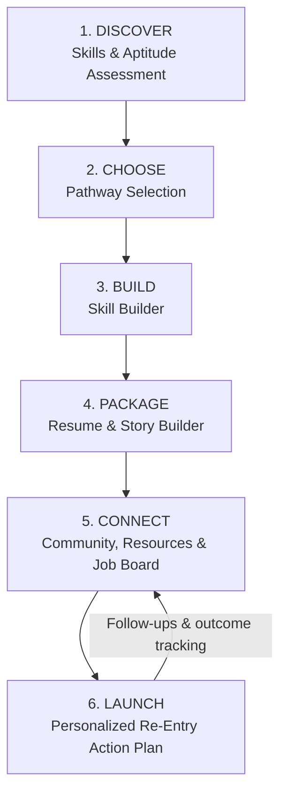

# Re-Entry: A Guided Pathway Back Into the Workforce

**AI Collective Hackathon — Project Workflow**

A nonprofit app that helps caregivers (especially stay-at-home parents) return to work after a long career break. The user doesn't just get information — they leave with **actual direction**: a personalized re-entry plan, a resume, a skill-building path, and real connections to community resources and jobs.

**Design principles:** Fun. Highly useful. Relentlessly encouraging. Built for people with 10 spare minutes at a time.

---

## The Problem

Caregivers face compounding barriers to re-entry:

| Barrier type | Examples |
|---|---|
| Confidence & identity | Imposter syndrome, lost professional identity, underselling caregiving as skilled work |
| Resume gap & bias | Gap stigma, ATS screening filters nonlinear histories, stale references |
| Skills & credentials | Outdated tools, lapsed certifications, unsure what still transfers |
| Networks & know-how | Shrunken network, unfamiliar job-search norms, interview rust |
| Practical & financial | Childcare cost/availability, schedule inflexibility, pay reset, benefits cliffs |
| Emotional & systemic | Guilt, isolation, family renegotiation, few structured returnship paths |

Most existing resources are scattered articles and generic resume tips. Nothing walks a returner from *"who am I now?"* to *"here is my plan."*

---

## The User Journey (Core Workflow)

### Stage 1 — DISCOVER: Skills & Aptitude Assessment
- Inventory **pre-gap career skills** AND **skills built during the gap** (budgeting, logistics, advocacy, crisis management, volunteer leadership)
- Aptitude/interest assessment — interests may have changed since their last job
- Short, bite-sized question sets (completable in <10 min chunks, progress always saved)
- Encouraging framing baked in: *"You just translated 6 years of caregiving into 12 professional skills"*
- **Output:** a skills profile + 2–3 suggested career pathways with honest fit reasoning (demand, flexibility, training time, pay range)

### Stage 2 — CHOOSE: Pathway Selection
- Compare pathways side-by-side: fastest re-entry vs. most growth vs. most flexibility
- Realistic view of what each requires: certifications, time, cost
- Simple money-math calculator: childcare cost vs. salary, **including the long-term view** (retirement, Social Security credits, raises) — the short-term math alone misleads
- Benefits-cliff warning for users on Medicaid/SNAP/childcare subsidies

### Stage 3 — BUILD: Skill Builder
- Gap-closing plan per pathway: specific courses, certifications, micro-credentials
- Prioritize **free/low-cost options** (community colleges, libraries, state workforce training grants)
- Visible progress tracking, streaks, and milestone celebrations tied to *their story*, not generic points

### Stage 4 — PACKAGE: Resume & Story Builder
- Resume builder that **handles the gap well**: translates caregiving into professional language, formats to survive ATS screening
- LinkedIn profile guidance
- A practiced "gap story" for interviews + interview refresher (video interview norms, what to wear now, salary negotiation)
- Rejection-recovery content for the inevitable discouragement valley

### Stage 5 — CONNECT: Community, Resources & Job Board
Three tiers of community connection (see next section), plus:
- Job board filtered for **returner-friendly employers**, returnships, flexible/part-time/remote roles
- Peer community / cohort circles — addresses isolation and confidence
- Mentor matching with volunteers (retired HR folks and recruiters love mentoring returners)

### Stage 6 — LAUNCH: The Exit Deliverable
Every user leaves with a **personalized re-entry action plan**:
- Chosen pathway + why it fits
- Skill plan with specific next courses
- Finished resume + gap story
- Target employers and live resource connections
- 30/60/90-day action steps

> The whole app is designed **backward from this deliverable**. Direction, not information.

---

## Community Resource Connection (3 Tiers)

**Tier 1 — Curated Directory (MVP)**
Searchable, vetted local resources keyed to *need* ("I need childcare to job hunt"), not org names: childcare assistance, workforce centers, free training, transportation, benefits programs. Quarterly link-review ownership — dead links destroy trust.

**Tier 2 — Smart Matching**
Assessment answers surface the right 3–5 resources, not a directory of 100. Plug into existing infrastructure:
- **211 (United Way)** — national social-services database, API available in many regions
- **American Job Centers / state workforce services** (e.g., Utah DWS, which also runs training grants)
- **findhelp.org (Aunt Bertha)** — social-services search platform with nonprofit integrations
- **Library systems** — free LinkedIn Learning, resume help, career coaching

**Tier 3 — Warm Handoffs**
Where a nonprofit beats a pure app: introductions, not links. MOUs with returner-friendly employers, referral pipelines where someone *expects the call*, mentor matching, moderated peer cohorts. A "request a connection" button that triggers human follow-up.

**Guiding rule:** every connection answers *"what's my next single step?"* — never "here are 40 options."

---

## Design & Experience Requirements

- **10-minute sessions:** every module completable in small bites; progress always saved (nap-time and pickup-line friendly)
- **Tone:** warm, plain language — encouraging without being saccharine; must also work for users returning after divorce or loss, not just "exciting new chapter!" energy
- **Celebration mechanics** tied to the user's own story and milestones
- **Accessibility:** plain reading level; Spanish-language support on the roadmap
- **Emotional-dip support:** check-in nudges when activity drops; "this is normal" content around rejections
- **Household module:** short worksheet for renegotiating who-does-what at home — a top reason returners quit
- **Privacy by design:** gaps, finances, and family situations are sensitive — minimize what's stored, be transparent about it

---

## MVP vs. Later Phases

| Phase | Scope |
|---|---|
| **MVP (hackathon)** | Discover assessment → pathway suggestions → resume/gap-story builder → Tier-1 resource directory → exit action plan |
| **Phase 2** | Skill builder with progress tracking, smart resource matching (Tier 2), job board, money-math & benefits-cliff calculators |
| **Phase 3** | Warm handoffs (Tier 3), mentor matching, peer cohorts, Spanish support, outcome dashboards for funders |

---

## Success Metrics (define from day one — funders will ask)

- % of users completing an exit action plan
- Resume completed / gap story practiced
- Resource connections made (and warm handoffs completed)
- Self-reported confidence lift (pre/post)
- Interviews landed and jobs landed at 30/60/90 days (follow-up prompts built in)
